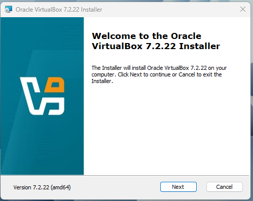
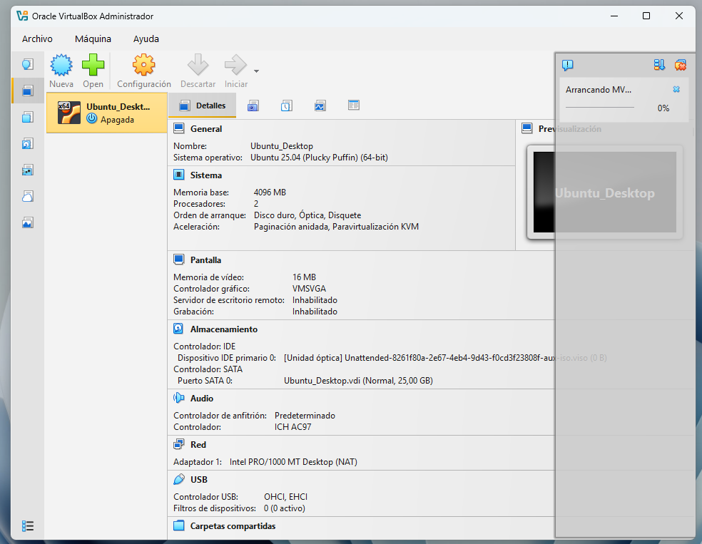
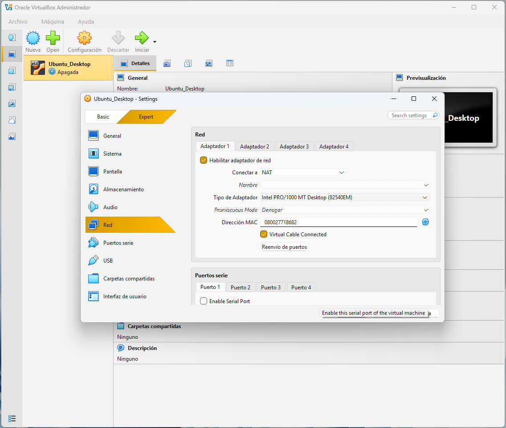
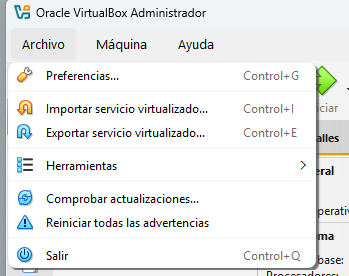

# **Guía de Instalación y Uso de MkDocs: Oracle VirtualBox**

**1. Inicio.**

Mediante las herramientas MkDocs y GitHub Pages vamos a realizar un proyecto técnico para una empresa o clientes sobre una guía de instalación, configuración y uso de VirtualBox.

Este proyecto tiene como objetivo que cualquier persona que nunca haya utilizado esta aplicación y la vaya a usar por primera vez pueda tener los conocimientos "mínimos" para poder crear máquinas virtuales y configurarlas a sus gustos.

Autores del proyecto: Nicolás Romero Rubiales y Miguel Ángel Marín Hernández.

**2. Introducción.**

**2.1. ¿Qué es?**

Oracle VirtualBox es una herramienta de virtualización de escritorio que permite a los usuarios ejecutar múltiples sistemas operativos en una única máquina física. Esto quiere decir que si tienes un ordenador con Windows/Linux/macOS puedes crear una máquina virtual con cualquier otro sistema operativo dentro de él para utilizarlo. Además, al ser de código abierto, es accesible y utilizado en diversas aplicaciones, desde pruebas de software hasta entornos de desarrollo.

Fue creado por la empresa alemana Innotek GmbH y actualmente es desarrollado por Oracle Corporation.

**2.2. Características principales.**

VirtualBox ofrece bastante más que una ventana donde arrancar otro sistema. Entre las funciones que utilizaremos a lo largo de esta serie se encuentran:

┬À Snapshots para guardar puntos de estado de una VM.

┬À Clonado de máquinas virtuales.

┬À Redes NAT, bridge, host-only, internal network y NAT Network.

┬À Firmware BIOS y UEFI según arquitectura y configuración.

┬À TPM virtual en escenarios compatibles.

┬À Discos virtuales VDI, VMDK y otros formatos soportados.

┬À Controladores de almacenamiento SATA, SCSI, NVMe y otros según plataforma.

┬À Guest Additions para mejorar la integración con el sistema invitado.

┬À Passthrough de determinados dispositivos USB.

┬À Importación y exportación OVF/OVA.

┬À Administración por línea de comandos con VBoxManage.

┬À Modo headless para ejecutar VMs sin mantener abierta la interfaz gráfica.

**3. Requisitos.**

Para una instalación correcta de VirtualBox en un ordenador necesitarás:

**Hardware:**

Procesador: Se recomienda un procesador con soporte de virtualización por hardware. Puede ser Intel VT-x o AMD-V.

Memoria RAM: Al menos 2GB de RAM dedicada a VirtualBox, aunque es recomendable más para un rendimiento óptimo.

**Espacio de almacenamiento:**

Al menos 200MB de espacio disponible en el disco duro para la instalación del software.

**Sistema operativo:**

Virtualbox es compatible con una amplia gama de sistemas operativos, incluyendo Windows, macOS, Linux y Solaris.

**Otros requisitos:**

Acceso de administrador: Es posible que necesites permisos de administrador en el sistema para poder instalar VirtualBox correctamente.

Conexión a internet: Para poder descargar la última versión de VirtualBox, con sus respectivas imágenes de sistemas operativos.

**4. Instalación y uso.**

**4.1. Descarga. (capturas 01 y 02)**

Entramos en la página oficial de VirtualBox y nos vamos al apartado de descargas, elegimos el sistema operativo en el que queremos el ejecutable, en este caso Windows hosts. La página ofrece la última versión. Una vez hecho, aparece descargado el .exe, lo siguiente sería darle doble clic para comenzar la instalación.

**4.2. Instalación. (capturas 03 - 10)**

Comenzada la instalación, la primera pantalla nos da la bienvenida del asistente y nos muestra la versión de VirtualBox con la arquitectura de 64 bits, le damos a "Next" y nos lleva a la siguiente pantalla en la que nos muestra el contrato de la licencia, gran parte del código GPL, marcamos el cuadro de que aceptamos los términos y le damos a "Next". La siguiente nos indica la selección de componentes, como VirtualBox Application, USB support, etc. Los componentes se dejan por defecto y la ruta nos indica dónde se ubica la instalación. Le damos a "Next" y en el siguiente apartado vemos un aviso que indica que la red se desconectará durante unos segundos durante la instalación, le damos a "Yes" y continuamos. En la siguiente pantalla nos indica que, si queremos usar VirtualBox desde Python, hacen falta una serie de componentes, le damos a "Yes". Después aparecen las opciones de inicio: añadir al menú de inicio, crear un acceso directo al escritorio y abrir los archivos OVA y OVF de VirtualBox. Se dejan marcadas como aparecen y le damos a "Next". Ya está listo para la instalación, indicamos "Install" y se procede a instalar todo. Por último, nos muestra que la instalación ha terminado y le damos a "Finish".

**4.3. Primer arranque. (captura 11)**

Se abre el administrador de VirtualBox, esta es la pantalla principal donde aparecerán todos los sistemas operativos que tengas.

**4.4. Crear la máquina virtual. (capturas 12-16)**

Para crear una máquina le damos al botón de "Nueva" y se abren las siguientes pestañas en las que tenemos que configurarlo como queramos. En la primera indicamos el nombre, la carpeta de las máquinas y, si tenemos la imagen ISO del sistema operativo, la seleccionamos. Una vez puesta la ISO, VirtualBox detecta el sistema operativo y su arquitectura. En la siguiente pestaña podemos poner el nombre y la contraseña del usuario y también indicar si queremos instalar las Guest Additions. En la siguiente indicamos cuánta memoria RAM y procesadores queremos utilizar en la máquina y, por último, cuántos GB utilizaremos en el disco duro. Una vez terminado podemos ver que se está iniciando Ubuntu junto con las características configuradas de dicha máquina.

**4.5. Uso de la máquina. (capturas 17-18)**

Vemos que Ubuntu se ha arrancado correctamente y podemos utilizarlo como cualquier otro sistema operativo.

Cuando apagamos la máquina aparece "Apagada" y la unidad óptica aparece vacía, ya que la ISO ya no se utiliza.

**4.6. Configuración de la máquina virtual Ubuntu. (capturas 19-21)**

Entramos en la configuración de Ubuntu Desktop y podemos destacar varias opciones y modificarlas. Las pestañas de General, Sistema, Almacenamiento y Red son las más destacadas, pudiendo modificar o añadir más almacenamiento o adaptadores de red en las máquinas.

**4.7. Menús principales. (capturas 22-23)**

En la pestaña inicial, en la parte superior izquierda existen varias pestañas que sirven como menús con distintas opciones. La primera es "Archivo", donde están las preferencias y ajustes generales, importar y/o exportar servicios virtualizados, herramientas, actualizaciones y advertencias. Después está la pestaña "Máquina", en la que encontramos acciones como Nueva, para crear una máquina virtual; Clonar, para duplicar una máquina; Mover y Eliminar; y iniciar, pausar, reiniciar y parar las máquinas, entre muchas otras opciones.

Keyboard Shortcuts

Keys

Action

?

Open this help

n

Next page

p

Previous page

s

Search
