

    
        
        
        
        
        
        
        * 
        Guia de instalacion y uso de una aplicaci├│n (Creaci├│n y despliegue de documentacion con MKdocs y Github Pages).
        
        
        
        
        
        
        
            html { scroll-behavior: smooth; }
            [id] { scroll-margin-top: 70px; }
        
        
        
        
        hljs.highlightAll(); 
    

    
        
            
                Guia de instalacion y uso de una aplicaci├│n (Creaci├│n y despliegue de documentacion con MKdocs y Github Pages).

                
                

                    
                        
                            
                                 Search
                            
                        

                    
                
            
        

        
            
                    
    
        
            
        
    

    
    
    
        * 
            Guía: Oracle VirtualBox
            
                1. Inicio

                * 2. Introducci├│n

                * 3. Requisitos

                * 
                    4. Instalaci├│n y uso
                    
                        4.1. Descarga

                        * 4.2. Instalaci├│n

                        * 4.3. Primer arranque

                        * 4.4. Crear la máquina virtual

                        * 4.5. Uso de la máquina

                        * 4.6. Configuraci├│n

                        * 4.7. Men├║s principales

                    
                
            
        
    


                    


## **Guía de Instalación y Uso de MkDocs: Oracle VirtualBox**






**1. Inicio.**


Mediante las herramientas MkDocs y GitHub Pages vamos a realizar un proyecto t├®cnico para una empresa o clientes sobre una gu├¡a de instalaci├│n, configuraci├│n y uso de VirtualBox.


Este proyecto tiene como objetivo que cualquier persona que nunca haya utilizado esta aplicaci├│n y la vaya a usar por primera vez pueda tener los conocimientos ÔÇ£m├¡nimosÔÇØ para poder crear m├íquinas virtuales y configurarlas a sus gustos.


Autores del proyecto: Nicolás Romero Rubiales y Miguel Ángel Marín Hernández.



**2. Introducci├│n.**


**2.1. ┬┐Qu├® es?**


Oracle VirtualBox es una herramienta de virtualizaci├│n de escritorio que permite a los usuarios ejecutar m├║ltiples sistemas operativos en una ├║nica m├íquina f├¡sica. Esto quiere decir que si tienes un ordenador con Windows/Linux/macOS puedes crear una m├íquina virtual con cualquier otro sistema operativo dentro de ├®l para utilizarlo. Adem├ís, al ser de c├│digo abierto, es accesible y utilizado en diversas aplicaciones, desde pruebas de software hasta entornos de desarrollo.


Fue creado por la empresa alemana Innotek GmbH y actualmente es desarrollado por Oracle Corporation.



**2.2. Características principales.**


VirtualBox ofrece bastante más que una ventana donde arrancar otro sistema. Entre las funciones que utilizaremos a lo largo de esta serie se encuentran:


┬À Snapshots para guardar puntos de estado de una VM.


┬À Clonado de m├íquinas virtuales.


┬À Redes NAT, bridge, host-only, internal network y NAT Network.


┬À Firmware BIOS y UEFI seg├║n arquitectura y configuraci├│n.


┬À TPM virtual en escenarios compatibles.


┬À Discos virtuales VDI, VMDK y otros formatos soportados.


┬À Controladores de almacenamiento SATA, SCSI, NVMe y otros seg├║n plataforma.


┬À Guest Additions para mejorar la integraci├│n con el sistema invitado.


┬À Passthrough de determinados dispositivos USB.


┬À Importaci├│n y exportaci├│n OVF/OVA.


┬À Administraci├│n por l├¡nea de comandos con VBoxManage.


┬À Modo headless para ejecutar VMs sin mantener abierta la interfaz gr├ífica.



**3. Requisitos.**


Para una instalación correcta de VirtualBox en un ordenador necesitarás:


**Hardware:**


Procesador: Se recomienda un procesador con soporte de virtualizaci├│n por hardware. Puede ser Intel VT-x o AMD-V.


Memoria RAM: Al menos 2GB de RAM dedicada a VirtualBox, aunque es recomendable más para un rendimiento óptimo.


**Espacio de almacenamiento:**


Al menos 200MB de espacio disponible en el disco duro para la instalaci├│n del software.


**Sistema operativo:**


Virtualbox es compatible con una amplia gama de sistemas operativos, incluyendo Windows, macOS, Linux y Solaris.


**Otros requisitos:**


Acceso de administrador: Es posible que necesites permisos de administrador en el sistema para poder instalar VirtualBox correctamente.


Conexión a internet: Para poder descargar la última versión de VirtualBox, con sus respectivas imágenes de sistemas operativos.



**4. Instalaci├│n y uso.**



**4.1. Descarga. (capturas 01 y 02)**


Entramos en la página oficial de VirtualBox y nos vamos al apartado de descargas, elegimos el sistema operativo en el que queremos el ejecutable, en este caso Windows hosts. La página ofrece la última versión. Una vez hecho, aparece descargado el .exe, lo siguiente sería darle doble clic para comenzar la instalación.


    
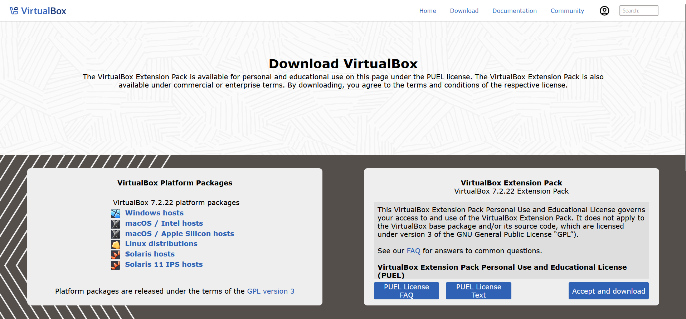

    
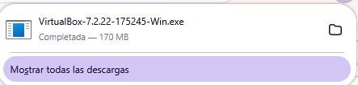




**4.2. Instalaci├│n. (capturas 03 - 10)**


Comenzada la instalaci├│n, la primera pantalla nos da la bienvenida del asistente y nos muestra la versi├│n de VirtualBox con la arquitectura de 64 bits, le damos a ÔÇ£NextÔÇØ y nos lleva a la siguiente pantalla en la que nos muestra el contrato de la licencia, gran parte del c├│digo GPL, marcamos el cuadro de que aceptamos los t├®rminos y le damos a ÔÇ£NextÔÇØ. La siguiente nos indica la selecci├│n de componentes, como VirtualBox Application, USB support, etc. Los componentes se dejan por defecto y la ruta nos indica d├│nde se ubica la instalaci├│n. Le damos a ÔÇ£NextÔÇØ y en el siguiente apartado vemos un aviso que indica que la red se desconectar├í durante unos segundos durante la instalaci├│n, le damos a ÔÇ£YesÔÇØ y continuamos. En la siguiente pantalla nos indica que, si queremos usar VirtualBox desde Python, hacen falta una serie de componentes, le damos a ÔÇ£YesÔÇØ. Despu├®s aparecen las opciones de inicio: a├▒adir al men├║ de inicio, crear un acceso directo al escritorio y abrir los archivos OVA y OVF de VirtualBox. Se dejan marcadas como aparecen y le damos a ÔÇ£NextÔÇØ. Ya est├í listo para la instalaci├│n, indicamos ÔÇ£InstallÔÇØ y se procede a instalar todo. Por ├║ltimo, nos muestra que la instalaci├│n ha terminado y le damos a ÔÇ£FinishÔÇØ.


    


    
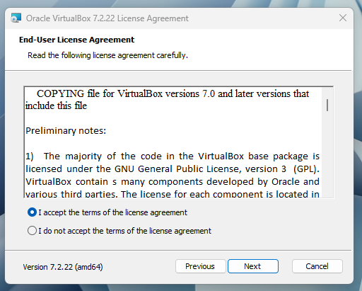

    
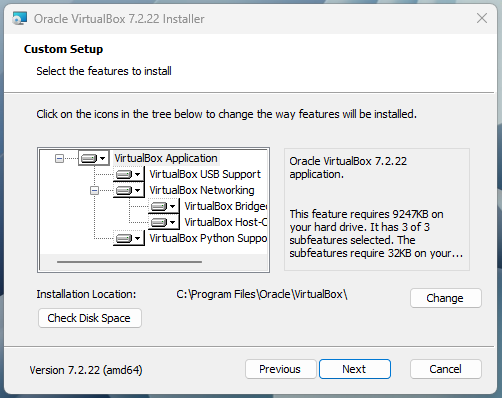

    
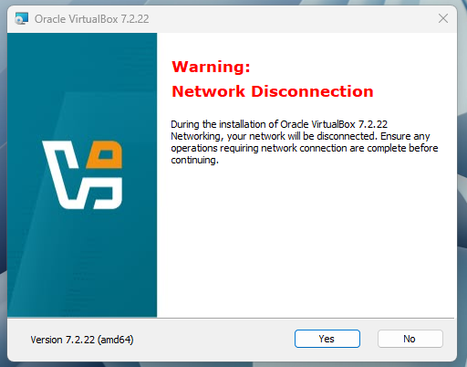

    
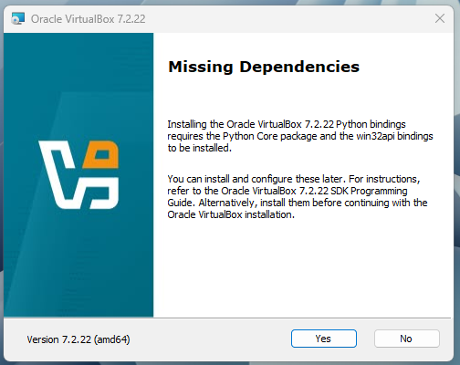

    
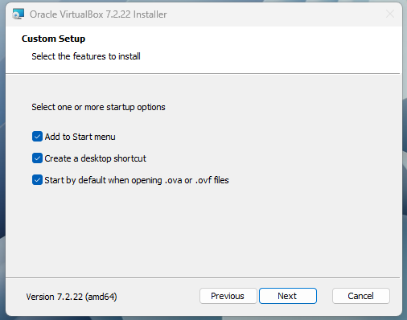

    
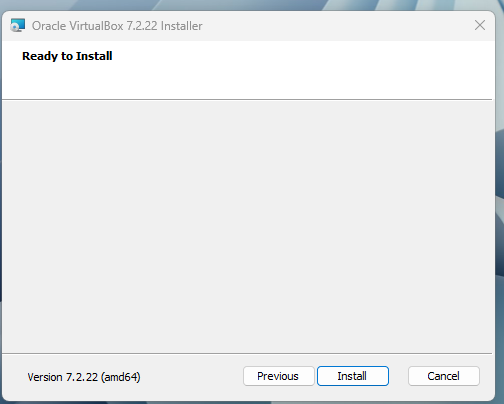

    
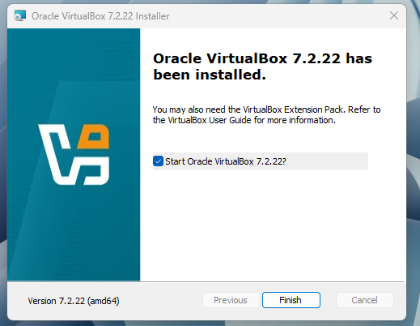




**4.3. Primer arranque. (captura 11)**


Se abre el administrador de VirtualBox, esta es la pantalla principal donde aparecerán todos los sistemas operativos que tengas.


    
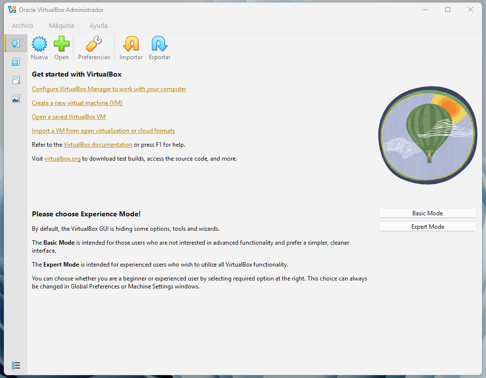




**4.4. Crear la máquina virtual. (capturas 12-16)**


Para crear una m├íquina le damos al bot├│n de ÔÇ£NuevaÔÇØ y se abren las siguientes pesta├▒as en las que tenemos que configurarlo como queramos. En la primera indicamos el nombre, la carpeta de las m├íquinas y, si tenemos la imagen ISO del sistema operativo, la seleccionamos. Una vez puesta la ISO, VirtualBox detecta el sistema operativo y su arquitectura. En la siguiente pesta├▒a podemos poner el nombre y la contrase├▒a del usuario y tambi├®n indicar si queremos instalar las Guest Additions. En la siguiente indicamos cu├ínta memoria RAM y procesadores queremos utilizar en la m├íquina y, por ├║ltimo, cu├íntos GB utilizaremos en el disco duro. Una vez terminado podemos ver que se est├í iniciando Ubuntu junto con las caracter├¡sticas configuradas de dicha m├íquina.


    
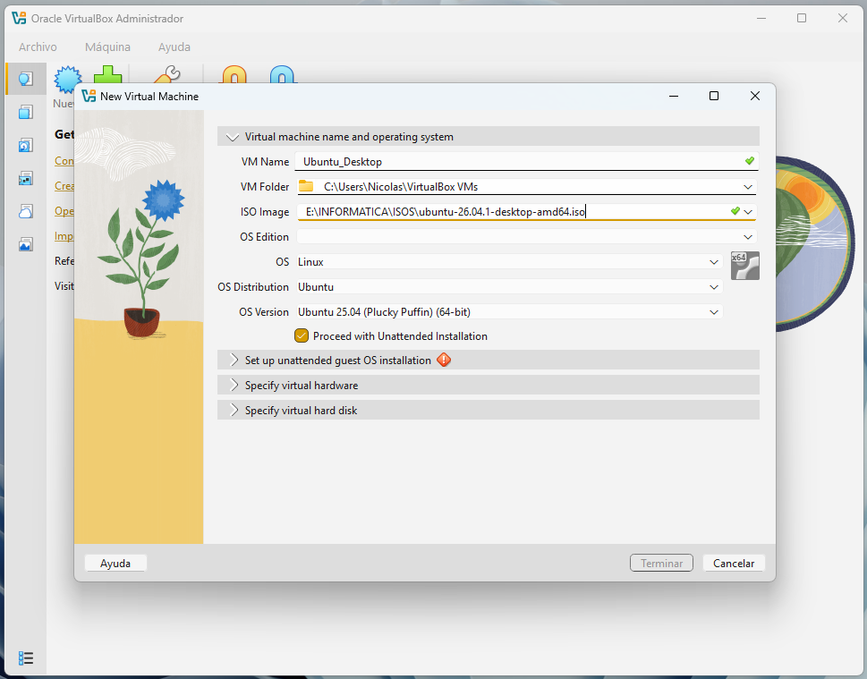

    
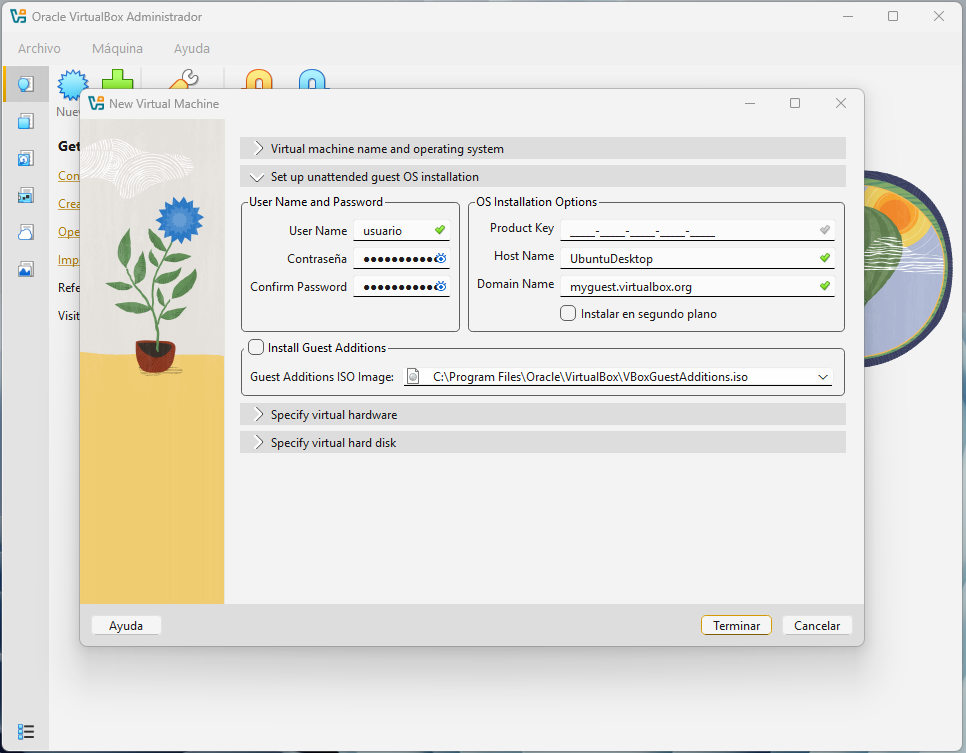


    


    
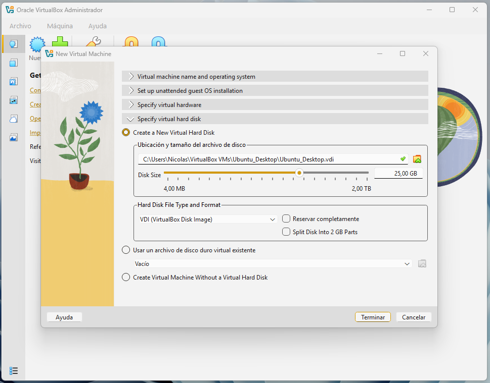

    





**4.5. Uso de la máquina. (capturas 17-18)**


Vemos que Ubuntu se ha arrancado correctamente y podemos utilizarlo como cualquier otro sistema operativo.


Cuando apagamos la m├íquina aparece ÔÇ£ApagadaÔÇØ y la unidad ├│ptica aparece vac├¡a, ya que la ISO ya no se utiliza.


    
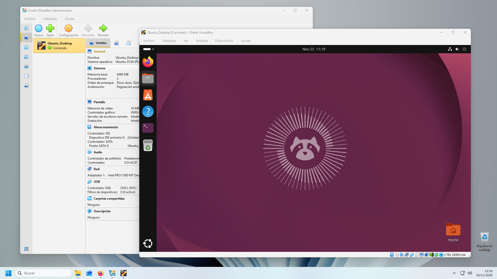

    
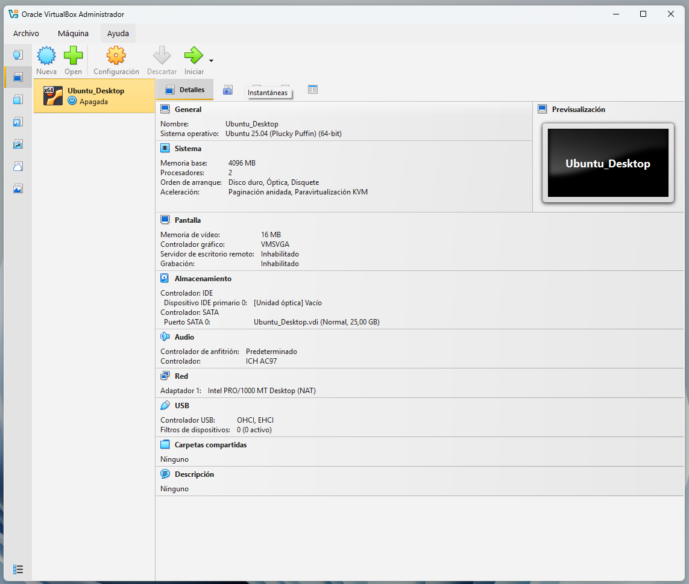




**4.6. Configuración de la máquina virtual Ubuntu. (capturas 19-21)**


Entramos en la configuración de Ubuntu Desktop y podemos destacar varias opciones y modificarlas. Las pestañas de General, Sistema, Almacenamiento y Red son las más destacadas, pudiendo modificar o añadir más almacenamiento o adaptadores de red en las máquinas.


    
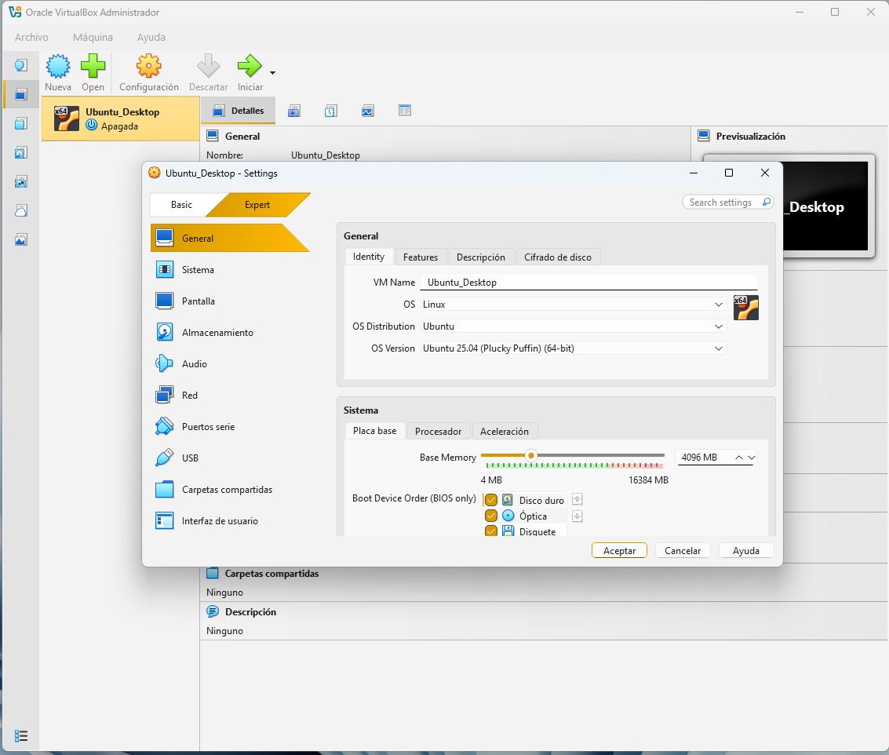

    


    





**4.7. Men├║s principales. (capturas 22-23)**


En la pesta├▒a inicial, en la parte superior izquierda existen varias pesta├▒as que sirven como men├║s con distintas opciones. La primera es ÔÇ£ArchivoÔÇØ, donde est├ín las preferencias y ajustes generales, importar y/o exportar servicios virtualizados, herramientas, actualizaciones y advertencias. Despu├®s est├í la pesta├▒a ÔÇ£M├íquinaÔÇØ, en la que encontramos acciones como Nueva, para crear una m├íquina virtual; Clonar, para duplicar una m├íquina; Mover y Eliminar; y iniciar, pausar, reiniciar y parar las m├íquinas, entre muchas otras opciones.


    


    
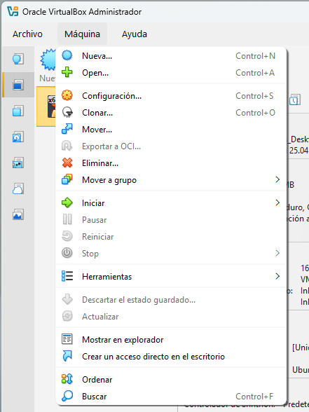



            
            
        
    

    
        
            
                Keyboard Shortcuts
                
            
            
              
                
                  
                    Keys
                    Action
                  
                
                
                  
                    ?
                    Open this help
                  
                  
                    n
                    Next page
                  
                  
                    p
                    Previous page
                  
                  
                    s
                    Search
